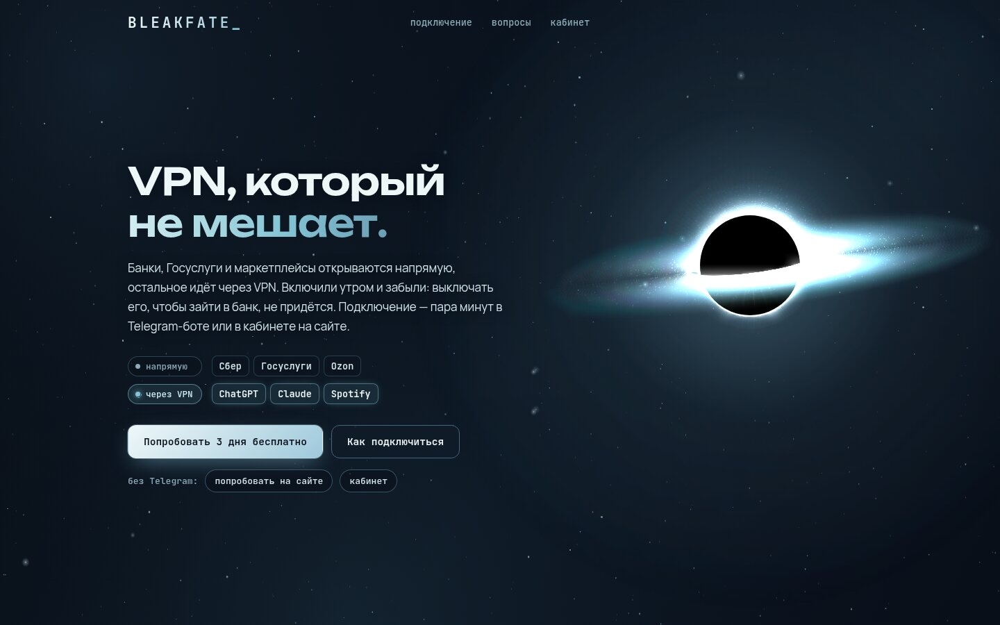

  

<h1 align="center">MostViable</h1>

  <b>I build and run BLEAKFATE, a VPN service, end to end.</b>

  Servers, the subscription layer, a Telegram bot with payments, and the website. One person, in production.

  
  
  
  

  <a href="https://mostviable.bleakfate.com"><b>mostviable.bleakfate.com</b></a> ·
  <a href="https://bleakfate.com">bleakfate.com</a> ·
  <a href="https://t.me/BleakFateBot">@BleakFateBot</a> ·
  <a href="README.ru.md">Русская версия</a>

 

  
   <b>bleakfate.com, the first screen.</b> Banks and Gosuslugi open directly, ChatGPT, Claude and Spotify go through the VPN.

  <a href="#bleakfate">BLEAKFATE</a> ·
  <a href="#projects">Projects</a> ·
  <a href="#stack">Stack</a> ·
  <a href="#contact">Contact</a>

## BLEAKFATE

- **[bleakfate.com](https://bleakfate.com)** — landing page and web cabinet: sign-in, checkout, devices, order history
- **[@BleakFateBot](https://t.me/BleakFateBot)** — Telegram bot: free trials, payments by bank transfer and crypto, referrals, promo codes, devices, admin panel
- Nodes in the Netherlands, Germany and Poland on Remnawave + Xray: VLESS Reality, XHTTP through a CDN for mobile networks, Hysteria 2; an "Auto" profile sticks to a working server
- Subscription layer with per-device limits, readable status lines in the client apps, and a cache that keeps it serving if the panel goes down
- Support bot with tickets as forum topics, watchdogs that report to Telegram

## Projects

| | Project | What it is | Live |
|:-:|---|---|---|
|  | **BLEAKFATE VPN** | The VPN service, the bot and the website | [bleakfate.com](https://bleakfate.com) |
|  | **MostViable Card** | My portfolio | [mostviable.bleakfate.com](https://mostviable.bleakfate.com) |
|  | **Lumberjack Clicker** | An idle clicker for Yandex Games in plain JavaScript, no build step | — |

## Stack

Go · Python · JavaScript · Linux · Bash · Docker · Nginx · Git

## Contact

Telegram [@MostViable](https://t.me/MostViable)

The icons are drawn in SVG for this profile; the layout follows the style of the [ArtCraft](https://github.com/storytold/artcraft) apps.
