  <picture>
    <source media="(max-width: 600px)" srcset="assets/header-bleakfate-mobile.svg"/>
    
  </picture>

I build and run **BLEAKFATE**, a VPN service, end to end: servers, the subscription layer, a Telegram bot with payments, and the website.
Portfolio: **[mostviable.bleakfate.com](https://mostviable.bleakfate.com)**

### BLEAKFATE

- **[bleakfate.com](https://bleakfate.com)** — landing page and web cabinet: sign-in, checkout, devices, order history
- **[@BleakFateBot](https://t.me/BleakFateBot)** — Telegram bot: free trials, payments by bank transfer and crypto, referrals, promo codes, devices, admin panel
- Nodes in the Netherlands, Germany and Poland on Remnawave + Xray: VLESS Reality, XHTTP through a CDN for mobile networks, Hysteria 2; an "Auto" profile sticks to a working server
- Subscription layer with per-device limits, readable status lines in the client apps, and a cache that keeps it serving if the panel goes down
- Support bot with tickets as forum topics, watchdogs that report to Telegram

### Also

- **Lumberjack Clicker** — an idle clicker for Yandex Games in plain JavaScript, no build step

**Stack:** Go · Python · JavaScript · Linux · Bash · Docker · Nginx · Git

**Contact:** Telegram [@MostViable](https://t.me/MostViable)
