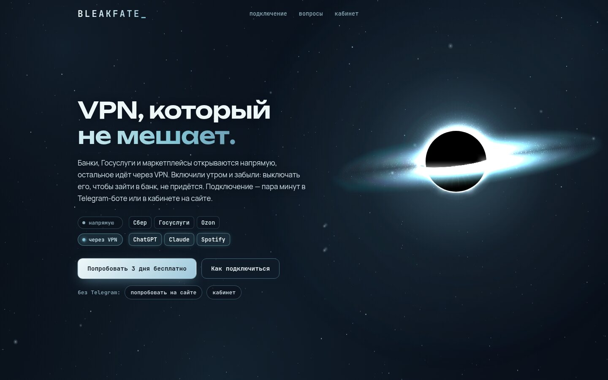
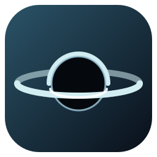

  

<h1 align="center">MostViable</h1>

  <b>Делаю и веду BLEAKFATE — VPN-сервис — целиком, от серверов до сайта.</b>

  Серверы, слой подписки, Telegram-бот с оплатой и сайт. Один человек, в работе.

  
  
  
  

  <a href="https://mostviable.bleakfate.com"><b>mostviable.bleakfate.com</b></a> ·
  <a href="https://bleakfate.com">bleakfate.com</a> ·
  <a href="https://t.me/BleakFateBot">@BleakFateBot</a> ·
  <a href="README.md">English</a>

 

  
   <b>bleakfate.com, первый экран.</b> Банки и Госуслуги открываются напрямую, ChatGPT, Claude и Spotify — через VPN.

  <a href="#bleakfate">BLEAKFATE</a> ·
  <a href="#проекты">Проекты</a> ·
  <a href="#стек">Стек</a> ·
  <a href="#связь">Связь</a>

## BLEAKFATE

- **[bleakfate.com](https://bleakfate.com)** — лендинг и личный кабинет: вход, оплата, устройства, история заказов
- **[@BleakFateBot](https://t.me/BleakFateBot)** — Telegram-бот: пробный период, оплата по СБП, картой и криптой, рефералы, промокоды, устройства, админка
- Ноды в Нидерландах, Германии и Польше на Remnawave + Xray: VLESS Reality, XHTTP через CDN для мобильных сетей, Hysteria 2; профиль «Авто» держится за работающий сервер
- Слой подписки с лимитом устройств, понятными строками статуса в приложениях и кэшем, который отвечает, даже если панель упала
- Бот поддержки с тикетами-темами, сторожа, которые пишут в Telegram

## Проекты

| | Проект | Что это | Где посмотреть |
|:-:|---|---|---|
|  | **BLEAKFATE VPN** | VPN-сервис, бот и сайт | [bleakfate.com](https://bleakfate.com) |
|  | **Визитка MostViable** | Моё портфолио | [mostviable.bleakfate.com](https://mostviable.bleakfate.com) |
|  | **Лесоруб-кликер** | Кликер для Яндекс Игр на чистом JavaScript, без сборки | — |

## Стек

Go · Python · JavaScript · Linux · Bash · Docker · Nginx · Git

## Связь

Telegram [@MostViable](https://t.me/MostViable)

Иконки нарисованы в SVG для этого профиля, оформление повторяет стиль приложений [ArtCraft](https://github.com/storytold/artcraft).
